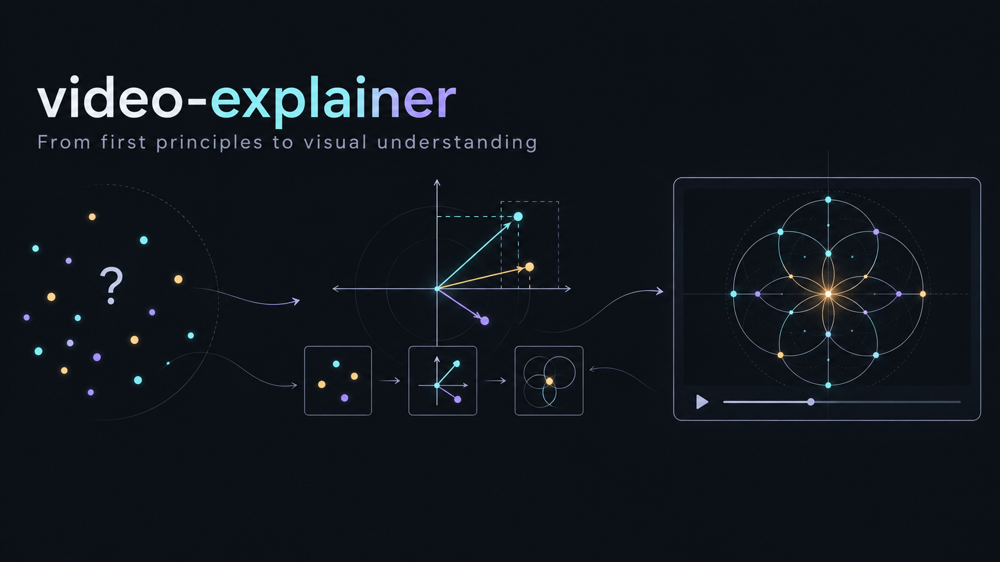

# video-explainer · 视频讲解



**从具体问题出发，让概念在推演中出现。**

一个面向 Codex 的知识讲解 skill，用于设计中文讲稿、字幕、分镜与机制动画。借鉴 3Blue1Brown 的视觉讲解方法，优先使用 Manim 制作数学、算法与科研解释。

[讲解方法](references/first-principles.md) · [分镜模板](references/storyboard-template.md) · [动作设计](references/motion-design.md) · [Manim 制作](references/manim-workflow.md) · [交互演示](assets/mechanism-demo.html)

## 为什么这样讲

看到定义，未必理解定义为什么需要存在。这个 skill 从观众能够接受的事实、约束和操作开始，用一个贯穿例子逐步建立关系：

**具体问题 → 基本事实与约束 → 预测 → 操作与观察 → 推出关系 → 引入术语 → 检验新情况**

例如解释 PPV，先展示“20人中8人有效；模型圈出6人，其中4人有效”，让观众数出4/6，再为这个比例命名。接着收紧选择范围，观察可靠性和漏掉的人数怎样一起变化，引出阈值与灵敏度。

数学关系展示推导，经验结论注明证据。动画承担解释：筛选揭示分母、投影揭示信息损失、变量变化揭示关系与不变量。

## 让动画与短字幕共同解释

先明确观众已经学过什么。面向只有数学分析基础的观众时，从函数、导数、积分与三角函数建立关系，再引入所需术语。

- 把复制、加权、换元与累加做成可观察的过程，核对中间状态。
- 用同一参数驱动曲线、图像和数值，保持角色颜色与显示尺度一致。
- 按语义项追踪公式中的变量替换和系数对应。
- 字幕一句表达一个短意思，并与当前动作或读图停顿对应。
- 先试制最难的一镜，再扩充全片；记录实际渲染时钟生成字幕与章节。

详见 [让动作承担推理](references/motion-design.md)。新增 [联动模板](assets/manim_motion_template.py) 用同一振幅参数更新曲线、振幅柱与二维条纹，无需 TeX：

```powershell
python -m manim -ql assets/manim_motion_template.py CoupledViews
```

## 可以做什么

| 任务 | 交付 |
|---|---|
| 设计知识讲解 | 学习目标、贯穿例子、可讲的文字和分镜 |
| 制作机制动画 | Manim 场景源码、预览、按要求渲染 MP4 |
| 制作无配音视频 | 可独立读懂的字幕、观察停顿与动画节拍 |
| 分析参考视频 | 时间码、状态变化、讲解逻辑与可迁移方法 |
| 修订已有讲稿 | 概念依赖、必要性推导、反例与迁移问题 |

## 安装到 Codex

将仓库克隆到 Codex 的 skills 目录：

```powershell
git clone https://github.com/Songjun113/video-explainer.git "$env:USERPROFILE\.codex\skills\video-explainer"
```

macOS / Linux：

```bash
git clone https://github.com/Songjun113/video-explainer.git ~/.codex/skills/video-explainer
```

若配置了自定义 `CODEX_HOME`，安装到该目录的 `skills/video-explainer`。目录已存在时更新已有副本。重启 Codex 后使用 `$video-explainer` 调用。

Skill 本身是说明文件；设计讲稿、分镜无需安装 Manim。渲染动画时再配置 Python、Manim 和中文字体。

## 使用示例

### 从第一性原理解释概念

```text
使用 $video-explainer，面向懂基础统计的研究生解释 PPV、Sensitivity 与 AUC。
从同一组虚构患者的选择与计数出发，让指标在推演中出现。
用阈值变化和排序反例检验理解，交付中文讲稿与动画分镜。
```

### 制作有字幕、无配音的视频

```text
使用 $video-explainer，把我提供的材料制作成约5分钟的中文讲解视频。
从基本事实和约束推到方法，使用同一个例子贯穿。
不要配音，烧录中文字幕；交付MP4、可编辑源码和来源说明。
```

### 改进已有讲稿

```text
使用 $video-explainer，改写这份讲稿。
找出每个概念的必要前提，让观众先预测、再观察、最后理解关系。
保留原始证据与适用范围，给出修订讲稿及关键机制分镜。
```

## 运行原创 Manim 示例

示例用固定二维点云演示旋转基、投影与残差。所有点均为教学构造，数值由点云实际计算；文字使用 Pango，无需 TeX。

```powershell
python -m venv .venv
& .\.venv\Scripts\python.exe -m pip install -r assets/requirements-manim.txt
& .\.venv\Scripts\python.exe -m manim -ql --renderer cairo --media_dir media assets/manim_scene.py ProjectionExplainer
```

需要中文字体，如 Microsoft YaHei 或 Noto Sans CJK SC。模板按 Manim Community 0.22.0 测试；ManimGL 与 Community 的导入和接口不同。细节见 [制作指南](references/manim-workflow.md)。

下载后可以直接用浏览器打开 [mechanism-demo.html](assets/mechanism-demo.html)，暂停、拖动时间或比较动画方法。

## 仓库结构

```text
video-explainer/
├── SKILL.md                       # Codex入口
├── agents/openai.yaml             # Skill显示信息
├── references/
│   ├── first-principles.md         # 推导方法与EEG教学示例
│   ├── storyboard-template.md      # 分镜记录
│   ├── motion-design.md           # 视觉节拍、语义变换与联动验收
│   ├── motion-recipes.md           # 机制动画方法
│   ├── manim-workflow.md           # 版本、实现与验证
│   ├── 3blue1brown-sources.md      # 官方资料与查证边界
│   └── source-analysis.md          # 参考视频方法分析
├── assets/                        # 原创演示与场景模板
└── docs/readme-banner.png          # image-gen生成的README插图
```

## 来源与许可

3Blue1Brown 与 Manim 的官方资料列在 [来源记录](references/3blue1brown-sources.md)。本项目为独立技能包，与 3Blue1Brown、Manim 或 OpenAI 无隶属关系。参考视频未随仓库分发；分析记录是对讲解方法的观察，不能确认其作者的制作软件。

仓库中的原创文字、代码与插图使用 [MIT License](LICENSE)。Manim 等依赖遵循各自许可证。README 插图由内置 image-gen 生成，提示词见 [banner-prompt.md](docs/banner-prompt.md)。
